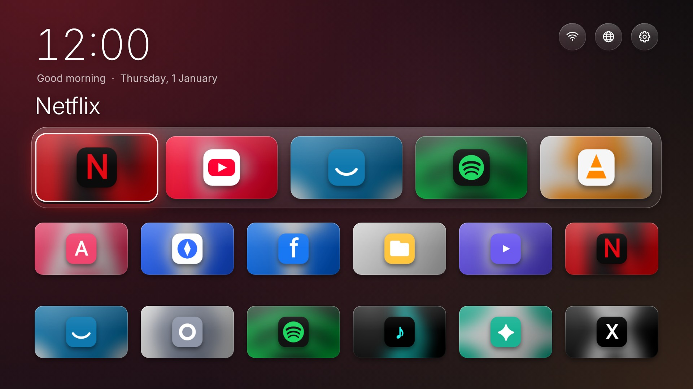
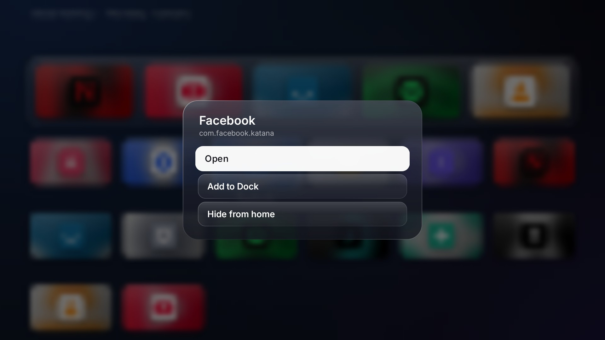
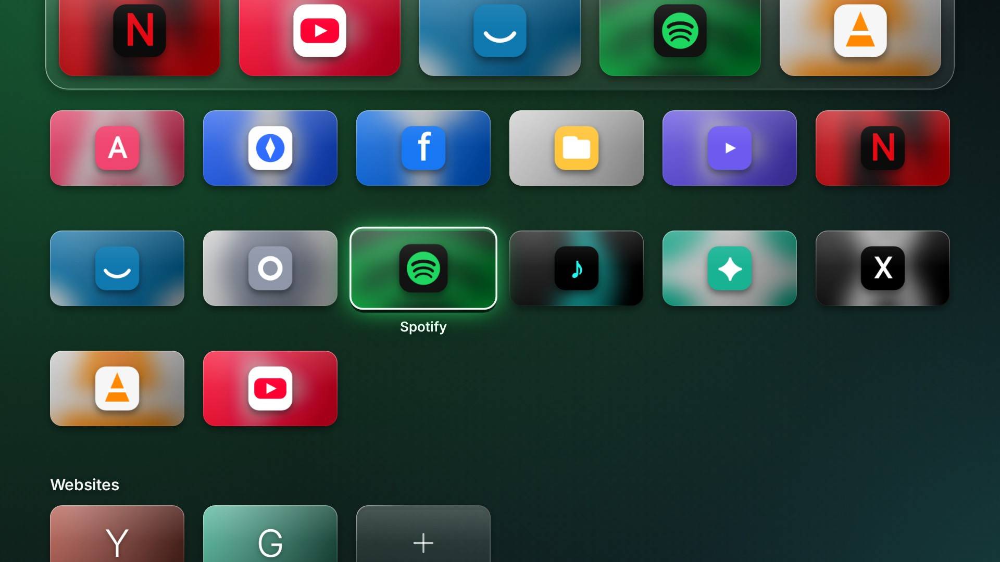
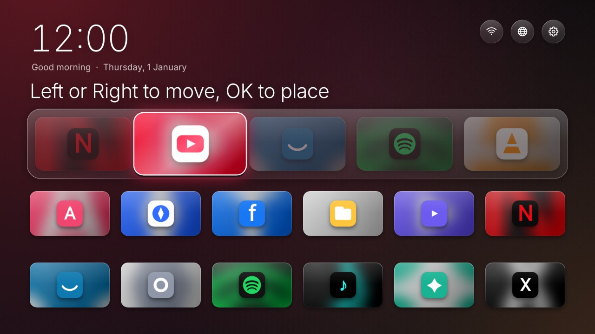
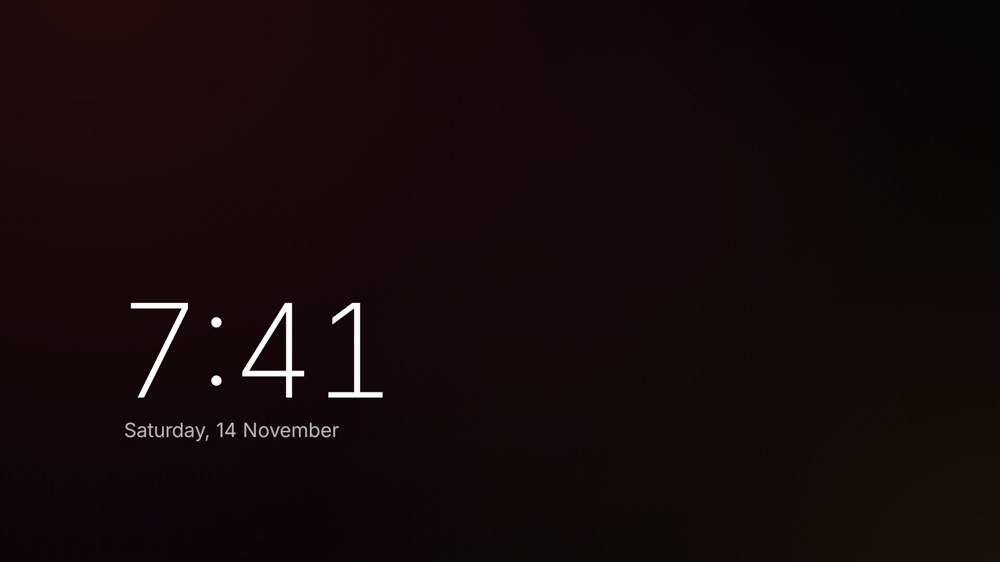

# Glass Home

A replacement home screen for generic Android smart TVs, in the spirit of tvOS: a quiet
clock, a glass dock for the apps you actually use, and everything else as a grid of 16:9
artwork. The room is lit in the colour of whatever you have highlighted.



| Hold OK on any tile | Scroll down for every app |
| --- | --- |
|  |  |

| Carrying a dock tile to a new place | The clock screensaver |
| --- | --- |
|  |  |

These images are drawn by the real app code in the test suite, with stand-in app icons.
The blur behind the menu is done by the TV's GPU (Android 12+) and is approximated here.

## What it does

- **A glass dock** for up to eight favourites, with a **headline above it** naming the
  one you are on. Tiles shrink to fit as the dock fills. Streaming apps already on the TV
  are placed there on first run.
- **Pick up and carry.** Hold **OK** on a dock tile and choose *Move*: Left and Right
  carry it along the dock while the others step back, OK puts it down.
- **Every app gets proper artwork.** TV apps show their own banner. Phone and tablet apps
  only ship a square icon, so their tile is built from it: the icon enlarged and blurred
  into a backdrop in the app's own colours, with the sharp icon floating on top.
- **Focus you can see from the sofa.** The highlighted tile springs forward, catches a
  streak of light and shows its name; the whole backdrop shifts to its colour. Buttons
  and menu rows turn white when highlighted.
- **Inputs.** If the TV has a source picker Glass Home knows how to open, a button for
  HDMI ports and live TV appears next to the network and settings buttons.
- **Hide the noise.** Hold OK on an app and choose *Hide from home*. It stays installed
  but disappears. Bring it back from *Settings > Hidden apps*.
- **Websites as tiles**, with the site's own icon. They open in **Brave** if it is
  installed (otherwise the TV's default browser). A built-in browser that drives an
  on-screen pointer with the arrow keys is there as a fallback, and can be made the
  default under *Settings > Websites open in*.
- **A clock screensaver** after five idle minutes (or fifteen, or never): the time, large
  and thin, moving to a new spot each minute.
- **Backdrops:** the ambient one that follows the highlight, plus four still ones.
- **Type:** set in [Inter](https://rsms.me/inter/), bundled.
- Small and light: a ~330 KB app with no background services, sized for 1.5 GB TVs.
  Everything scales to the panel, so it looks the same whatever density the firmware reports.

### Motion

Every movement answers a button press; an idle screen draws no frames at all.

- **The headline changes hands.** Moving along the dock, the old name lifts away as the
  new one rises into its place.
- **The highlight glides.** There is one focus ring for the whole screen. It travels
  from tile to tile with its leading edge ahead of its trailing edge, so it stretches
  like a drop of liquid and settles on the new tile, carrying a glow in that app's colour.
- **An opening sequence** of under a second: the clock eases down, the buttons pop in,
  the dock rises and the tiles arrive one after another.
- **Apps open out of their tile**, and coming back home the screen settles into place.
- **A shove at the edge.** Pressing a direction with nowhere to go nudges the tile and
  lets it spring back, instead of doing nothing.
- **Depth:** the backdrop drifts slightly as the page scrolls; menus spring up and their
  rows follow a beat apart.
- *Settings > Motion: reduced* switches all of it off for a TV that struggles.

[`docs/motion.mp4`](docs/motion.mp4) is a recording of these, stepped frame by frame from
the app code.

### Where the ideas come from

Two open-source projects that solve the same problem, both MIT-licensed, were read
closely before this version:

- **[CleanYourTV](https://github.com/Gathin23/cleanyourtv)**: the headline that names the
  focused dock app, picking a tile up to move it, the clock screensaver, the Inputs
  button, and above all its per-TV notes, which is where the Home-button and power-on
  fixes below come from. No code was copied; the ideas were rebuilt here.
- **[Free My TV](https://github.com/simbasjungles/free-my-tv)**: shipping a real typeface
  (it uses Inter too) and treating the home screen as something that should cost almost
  nothing to draw.

Also tvOS for the overall stage and its Liquid Glass material, the PlayStation 5 home
for a backdrop that follows the selection, and the Nintendo Switch for the shove at the
end of a row.

Both projects are far more widely tested than this one. If you would rather not be the
first person to run a launcher on your TV, use one of them.

### Remote cheat sheet

| Where | Key | Does |
| --- | --- | --- |
| Home | OK | Open |
| Home | Hold OK, or Menu | Options for that tile |
| Home | Back or Home | Jump to the top |
| Home, after *Move* | Left / Right, then OK | Carry the dock tile, then put it down |
| Built-in browser | Arrows | Move pointer; push an edge to scroll |
| Built-in browser | OK | Click |
| Built-in browser | Hold OK, hold Back, or Menu | Browser menu |
| Built-in browser | Back | Previous page, then exit |

## Install on the TV

The ready-built app is [`apk/glass-home.apk`](apk/glass-home.apk).

**With a USB stick (no computer tools needed)**

1. Copy `glass-home.apk` to a USB stick and plug it into the TV.
2. Open the TV's file manager / Media app, find the file and press OK. Allow
   "install from unknown sources" if asked.
3. Press **Home** on the remote. Choose **Glass Home** and **Always**.

**With ADB from a computer**

```bash
tools/tv.sh connect <tv-ip-address>
tools/tv.sh backup
tools/tv.sh install
tools/tv.sh set-home
```

### If your TV says "Production model: SMART_TV"

That info screen (firmware version, Android version, cores, GPU and little else) is what
CVTE firmware on HiSilicon chips shows. CleanYourTV has tested notes for a set like it
([sankey-smart-tv-hi3751v350](https://github.com/Gathin23/cleanyourtv/tree/main/examples/sankey-smart-tv-hi3751v350)),
and this app follows them. Whether your TV really is that firmware is unconfirmed until
`tools/tv.sh info` has been run against it.

- **Never disable the TV's own home screen.** On this firmware it can be the only one
  allowed to start at power-on; with it disabled the TV boots to a black screen with the
  remote dead. An earlier version of this README suggested disabling it. Do not.
  `tools/tv.sh disable` now refuses any home-screen package.
- **The Home button** is sent in a way an ordinary launcher never receives. Glass Home
  registers for it, and is marked as allowed to start at power-on.
- **ADB** may not be under Developer options, because there may be none. On the tested
  set it was in a factory menu: switch to a TV or HDMI source, press MENU then 1 1 4 7,
  and turn on DEBUG > ADB ENABLE. Touch nothing else in that menu, and turn ADB off
  again afterwards: while it is on, anyone on your network can control the TV.
- **App info and Uninstall** may not exist on the TV at all. Those menu rows only appear
  when the TV has a screen for them.

### Removing preinstalled apps for real

Hiding in Glass Home needs no computer and cannot break anything. To actually switch
preinstalled apps off, CleanYourTV's per-TV lists and its `tools/disable.sh` /
`tools/restore.sh` are the tested route. `tools/tv.sh disable <package>` here does the
same single step (`pm disable-user`, never uninstall), records what it switched off, and
`tools/tv.sh restore` switches it all back on.

## Honest limits

- **Tested on the JVM, not on your TV.** The home screen is exercised by 27 automated
  tests (focus movement, the animations, the dock, carrying, hiding, the screensaver,
  Home-button registration, scaling at 720p/1080p and different densities), but nobody
  has run this build on the actual hardware yet.
- **The firmware fixes are from someone else's notes on a similar TV**, not from yours.
  The Inputs button in particular only appears if your TV's source picker has the name
  recorded there.
- **The Netflix TV app.** If you sideload the Android TV build of Netflix
  (`com.netflix.ninja`), Glass Home shows it with its banner and puts it in the dock on
  first run. Whether it runs, and at what resolution, is decided by Netflix's own device
  checks, not by the launcher.
- **Brave is a touch browser.** It works with a mouse or air-mouse remote; with arrow keys
  alone, the built-in pointer browser is the easier one to drive.
- Website icons are fetched from the site itself the first time; sites that offer none
  get a letter tile.
- Updating to a build signed on another machine needs the old one uninstalled first
  (favourites are lost), because each machine has its own debug signing key.

## Build it yourself

Needs JDK 17+ and the Android SDK (platform 35).

```bash
./gradlew assembleRelease      # -> app/build/outputs/apk/release/app-release.apk
./gradlew testDebugUnitTest    # runs the tests and writes PNGs to app/build/screenshots
GLASS_REEL=1 ./gradlew testDebugUnitTest --tests '*MotionReel*'   # animation frames -> app/build/reel
```

Plain Kotlin and Android framework views, no libraries. Layout is in
`HomeActivity.kt`, the drawing of tiles, dock and buttons in `Views.kt`, the glass,
shadows and artwork generation in `Ui.kt`, backdrops in `Wallpapers.kt`, and the
built-in browser in `BrowserActivity.kt`. Inter is licensed under the SIL Open Font
License ([`licenses/Inter-OFL.txt`](licenses/Inter-OFL.txt)).
