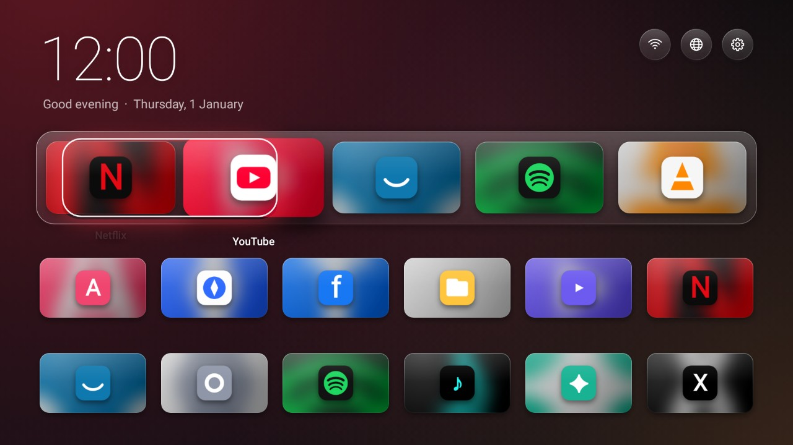
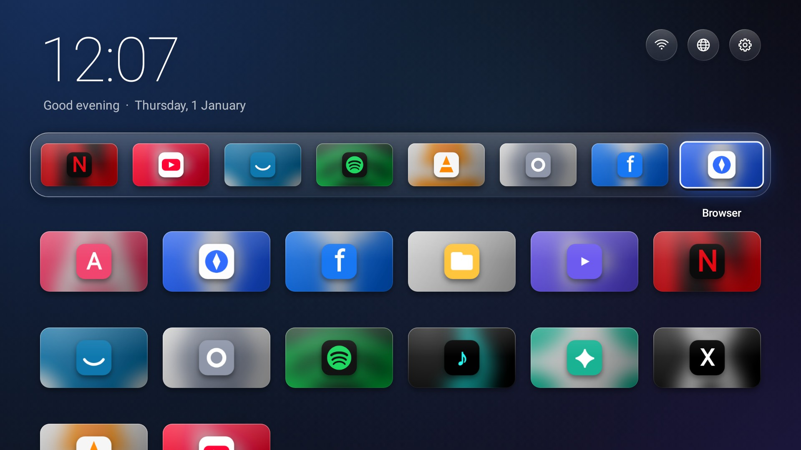

# Glass Home

A replacement home screen for generic Android smart TVs, in the spirit of tvOS: a big
quiet clock, a glass dock for the apps you actually use, and everything else as a grid
of 16:9 artwork. The room is lit in the colour of whatever you have highlighted.


| Hold OK on any tile | Scroll down for every app |
| --- | --- |
|  |  |

| The highlight in mid-glide between two tiles | A full dock |
| --- | --- |
|  |  |

These images are drawn by the real app code in the test suite, with stand-in app icons.
The blur behind the menu is done by the TV's GPU (Android 12+) and is approximated here.

## What it does

- **A glass dock** for up to eight favourites. Tiles shrink to fit as it fills, like a
  desktop dock. Streaming apps already on the TV are placed there on first run; hold
  **OK** on any tile to add, remove or reorder.
- **Every app gets proper artwork.** TV apps show their own banner. Phone and tablet apps
  only ship a square icon, so their tile is built from it: the icon enlarged and blurred
  into a backdrop in the app's own colours, with the sharp icon floating on top.
- **Focus you can see from the sofa.** The highlighted tile springs forward, catches a
  streak of light and shows its name; the whole backdrop shifts to its colour. Buttons
  and menu rows turn white when highlighted.
- **Hide the noise.** Hold OK on an app and choose *Hide from home*. It stays installed
  but disappears. Bring it back from *Settings > Hidden apps*.
- **Websites as tiles**, with the site's own icon. They open in **Brave** if it is
  installed (otherwise the TV's default browser). A built-in browser that drives an
  on-screen pointer with the arrow keys is there as a fallback, and can be made the
  default under *Settings > Websites open in*.
- **Backdrops:** the ambient one that follows the highlight, plus four still ones.
- Tiny and light: a ~270 KB app with no background services, sized for 1.5 GB TVs.
  Everything scales to the panel, so it looks the same whatever density the firmware reports.

### Motion

Every movement answers a button press; an idle screen draws no frames at all.

- **The highlight glides.** There is one focus ring for the whole screen. It travels
  from tile to tile with its leading edge ahead of its trailing edge, so it stretches
  like a drop of liquid and settles on the new tile, carrying a glow in that app's colour.
- **An opening sequence** of under a second: the clock eases down, the buttons pop in,
  the dock rises and the tiles arrive one after another.
- **Apps open out of their tile**, and coming back home the screen settles into place.
- **A shove at the edge.** Pressing a direction with nowhere to go nudges the tile and
  lets it spring back, instead of doing nothing.
- **Depth:** the backdrop drifts slightly as the page scrolls; menus spring up and their
  rows follow a beat apart.
- *Settings > Motion: reduced* switches all of it off for a TV that struggles.

[`docs/motion.mp4`](docs/motion.mp4) is a recording of these, stepped frame by frame from
the app code.

### Where the ideas come from

tvOS for the overall stage (dock, 16:9 artwork, caption only on the focused item, white
focused controls) and its Liquid Glass material for the dock and buttons; the
PlayStation 5 home for a backdrop that follows the selection; the Nintendo Switch for
the shove at the end of a row; Projectivy Launcher, the best-regarded Android TV
replacement, for the lesson that people want to hide and reorder things themselves.

### Remote cheat sheet

| Where | Key | Does |
| --- | --- | --- |
| Home | OK | Open |
| Home | Hold OK, or Menu | Options for that tile |
| Home | Back or Home | Jump to the top |
| Built-in browser | Arrows | Move pointer; push an edge to scroll |
| Built-in browser | OK | Click |
| Built-in browser | Hold OK, hold Back, or Menu | Browser menu |
| Built-in browser | Back | Previous page, then exit |

## Install on the TV

The ready-built app is [`apk/glass-home.apk`](apk/glass-home.apk).

**With a USB stick (no computer tools needed)**

1. Copy `glass-home.apk` to a USB stick and plug it into the TV.
2. Open the TV's file manager / Media app, find the file and press OK. Allow
   "install from unknown sources" if asked.
3. Press **Home** on the remote. Choose **Glass Home** and **Always**.

**With ADB from a computer**

```bash
tools/tv.sh connect <tv-ip-address>
tools/tv.sh install
tools/tv.sh set-home
```

If pressing Home still opens the old launcher (some firmwares hard-wire it), find its
package with `tools/tv.sh info` and switch it off with `tools/tv.sh disable <package>`.
That is reversible with `tools/tv.sh enable <package>`. Only do this once Glass Home is
installed and opening correctly, otherwise the TV has no home screen to return to.

The same script removes preinstalled clutter for real (not just hiding it):
`tools/tv.sh list` shows package names, `tools/tv.sh disable <package>` switches one off.
Leave anything you do not recognise alone; system pieces often have unhelpful names.

## Honest limits

- **Tested on the JVM, not on your TV.** The home screen is exercised by 22 automated
  tests (focus movement, the animations, the dock, hiding, scaling at 720p/1080p and
  different densities),
  but nobody has run this build on the actual hardware yet.
- **The Netflix TV app.** If you sideload the Android TV build of Netflix
  (`com.netflix.ninja`), Glass Home shows it with its banner and puts it in the dock on
  first run. Whether it runs, and at what resolution, is decided by Netflix's own device
  checks, not by the launcher.
- **Brave is a touch browser.** It works with a mouse or air-mouse remote; with arrow keys
  alone, the built-in pointer browser is the easier one to drive.
- Website icons are fetched from the site itself the first time; sites that offer none
  get a letter tile.
- Updating to a build signed on another machine needs the old one uninstalled first
  (favourites are lost), because each machine has its own debug signing key.

## Build it yourself

Needs JDK 17+ and the Android SDK (platform 35).

```bash
./gradlew assembleRelease      # -> app/build/outputs/apk/release/app-release.apk
./gradlew testDebugUnitTest    # runs the tests and writes PNGs to app/build/screenshots
GLASS_REEL=1 ./gradlew testDebugUnitTest --tests '*MotionReel*'   # animation frames -> app/build/reel
```

Plain Kotlin and Android framework views, no libraries. Layout is in
`HomeActivity.kt`, the drawing of tiles, dock and buttons in `Views.kt`, the glass,
shadows and artwork generation in `Ui.kt`, backdrops in `Wallpapers.kt`, and the
built-in browser in `BrowserActivity.kt`.
